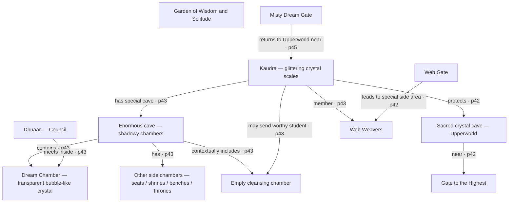

# Mission 001 — Kaudra's Cave: source-critical map brief

**Project:** I love you too William's Dragon Cavern  
**Document ID:** `DC-MAP-001-KAUDRA-CAVE`  
**Date:** 24 October 2026  
**Scope:** Kaudra, her special cave, Dream Chamber, Dhuaar, side chambers, cleansing chamber and associated *but not necessarily connected* sites.  
**Atlas status:** **LOCATED and SOURCE-SYNTHESIZED**, existing individual facts user-approved (Tests X, AD, L, N, related gate tests); **this newly assembled map brief and any artwork/gameplay await William's review**.  
**Game status:** The existing repository had no playable game prototype at this checkpoint. This document is a source-relationship map, not a floor plan.
**Machine-readable evidence map:** [`game/data/kaudra-cave-evidence-graph.v1.json`](../game/data/kaudra-cave-evidence-graph.v1.json).

## 1. Reused research — not a new interpretation from scratch

Before consulting later pages again, we reused:

- `Dragon_Cavern_Atlas_Index_2026-10-14.md` (historically updated to Oct. 23): **approved Test X** Kaudra, **approved Test AD** Dream Chamber, **approved revised Test L** Dhuaar, associated Web Gate / Dream Gate tests, and the corrections register. This document is available in the project Library.
- `Williams_Dragon_Study_Record_2026-10-10.md` (project Library), especially **`DC-P042-001-L`** (William-corrected p.42 text) and **`DC-P043-001`** (William-confirmed page 43 passage index). The Book's printed page 43 was additionally shown/reviewed in a prior Oct. 23 conversation, according to the Atlas completion addendum. That original photograph **is not currently archived for direct independent re-reading in this session**. This is *not* a reason to discard the already approved Atlas results.
- User's original p.42–66 chapter video, selectively inspected at **printed p.45** (around 00:02.5): confirms the **misty Dream Gate**, if entered, returns a traveller to the **Upperworld near Kaudra**. This does **not** say it opens into the cave.
- `docs/001-kaudras-grotta.md`: prior Mission 001 milestone and protocol, which explicitly forbids drawing unsupported passages and requires relation-type labels.

**Evidence key:** `T` archived user-confirmed text; `H` earlier recorded visual verification without the current archived original photograph; `V` image checked in this targeted review; `A` individual prior approval; `C` cautious contextual association; `U` unverified.

**Status nuance:** Approval of an individual Kaudra fact (e.g., crystal scales) is **not** retrospective approval of a fully specified creature illustration, cave topology or this map's composition.

## 2. What we can establish inside Kaudra's enormous cave

### DC-BEING-X-KAUDRA — Kaudra
**Printed pp.41–43; evidence S/T/H/A.**

Kaudra is a **female seer dragon**, belonging to the **Web Weavers**. She is associated with **Upperworld**. In p.42's corrected source transcription she is explicitly given **glittering crystal scales**, but **not a fixed colour, horn count, wing outline, body size or crystal composition**. William definitively corrected the mistaken name **Madura**: there is **no second dragon by that name** in this passage. Web Weaver membership does **not** establish that Kaudra leads their group, nor that she sits on the Dhuaar.

### DC-KAUDRA-CAVE-HUGE — Enormous cave with shadowy chambers
**Printed p.43; evidence T/H/A.**

Page 43 describes **Kaudra's enormous cave**, featuring **shadowy chambers**. This is our parent *place* in this map. No cave entrance, tunnel, floor plan, cross-section, ceiling shape, geological material, scale, lighting source, passage lengths, compass directions, or distinct number of side chambers is provided.

### DC-PLACE-AD-DREAM-CHAMBER — Dream Chamber
**Printed p.43; evidence T/H/A, specifically approved Test AD.**

This chamber is described as **a huge, transparent, bubble-like crystal**, within Kaudra's cave. **The Dhuaar / High Council of the Multiverse meets inside** the crystal to deliberate on matters important to the **balance of the Multiverse**. In Conway's cosmology, the crystal shields members' thoughts from distracting/interfering vibrational chatter. The source does **not** provide dimensions, exact faceting, refractive colours, a circular floor plan, an entry portal, Council seating, the number or appearance of attendees, or a permanent throne *inside* it. Avoid drawing those as known objects.

**Strict exclusion:** `Dream Chamber` (crystal **inside the cave**) ≠ `Dream Gate` (misty **travelling gate** described on p.45). Distinct Atlas entities.

### DC-KAUDRA-SIDE-CHAMBERS — Other side chambers
**Printed p.43; evidence T/H/A.**

Other cave chambers collectively contain **meditation seats, small shrines, counsellor benches and thrones**. The passage **does not prescribe one separate room for each object type**. A God or Goddess may appear; when that happens, **archangels and angels stand beside the throne**. That is **conditional presence**, not permanent sculpted figures, and the source does not establish the precise room, throne geometry or layout.

### DC-KAUDRA-CLEANSING-CHAMBER — Empty cleansing chamber
**Printed p.43; evidence T/H/A.**

When **Kaudra judges a student ready and worthy**, she may send the student into an **empty chamber** for **cleansing** and opening the way to the student's highest spiritual connections, as claimed in the narrative. It is not the crystal Dream Chamber. The chamber's architecture, furnishings, actual doorway, relationship to the other unnamed side chambers and visual mechanism of cleansing **are not specified**. The source states the chamber is **empty**: do not add altar stones, benches, fountains or purification machines.

## 3. Related sites — no invented cave corridors

### P.42 sacred crystal cave near the Gate to the Highest
**`DC-KAUDRA-UPPERWORLD-CRYSTAL-CAVE`; printed p.42; T/H/A.**

Kaudra protects a **sacred crystal cave in the Upperworld**, **near the Gate to the Highest**. Her appearance includes **glittering crystal scales**. The text says she protects the **cave**, not that she is the Gate's guardian. Our existing Atlas deliberately preserves an unresolved **identity question**:

> Is this p.42 sacred crystal cave the **same** as the enormous p.43 cave containing the Dream Chamber?

**No conclusive source evidence has been recovered; do not merge the cave nodes.** Do not draw a linking tunnel either.

### Garden of Wisdom and Solitude
**`DC-KAUDRA-GARDEN-WISDOM`; printed p.43; T/H/A.**

The surrounding Upperworld passage describes a **Garden of Wisdom and Solitude**, bounded by a **high hedge**, seeming **endless**, and representing **many cultures**. Its source-named elements include **shrines, temples, gazebos, flower-covered shelters, flowers, streams, waterfalls, fountains, and small bridges crossing ponds**; visitors may encounter **students from throughout the Multiverse**.

**Spatial restraint:** The passage does **not** establish that this entire garden is a chamber **inside** Kaudra's cave, nor an exact cave-to-garden path or physical door. Do not blend hedge, temples and waterfalls into the cave's rock chambers as if Conway said they were there. Their relative order, size, material and cultural appearance are not given.

### The Shrine of Remembrance
**`DC-KAUDRA-SHRINE-REMEMBRANCE`; printed p.43; approved Test A.**

A separately approved sacred-site description supports spiritual growth, removal of **some** kinds of karma and assistance from an attending angel with remembrance/reconciliation in Conway's system. **Its placement within the garden or Kaudra's cave is NOT established**. Likewise it is not identical by default to the p.42 Shining Ones' pantheon shrines or the p.47 Shrine of Ancestors.

### Misty Dream Gate and Web Gate
- **Misty Dream Gate**: verified directly on **p.45** in this targeted review. Leads the traveller into the **Upperworld near Kaudra**, not specifically to a cave door. No connection from the Gate directly into Dream Chamber is described.
- **Web Gate**: p.42 source describes a **cobweb painting** and access to the **Web Weavers' special side area**; pp.43–44 establish Kaudra's Web Weaver membership. Neither connection establishes a corridor into her cave.

## 4. Source relationship map — NOT a physical floor plan

**Missing from this diagram intentionally:** `Garden` has no sourced traversable connection to the cave; `H` (p.42 crystal cave) and `C` (p.43 enormous cave) have no confirmed identity; Dream Gate leads *near Kaudra*, not directly into cave. Graph arrows are **semantic relations**, NOT one-way physical pathways. Position in the diagram is editorial layout only.

## 5. Register of six unresolved physical connections

| ID | Question | Present status | Treatment |
|---|---|---|---|
| U-001 | Are the p.42 crystal cave and p.43 enormous cave one location? | **Unresolved** | Two distinct reference nodes; never draw connection |
| U-002 | Where is Garden of Wisdom and Solitude relative to cave? | **Unresolved** | Separate place, no doorway/path |
| U-003 | Is Shrine of Remembrance within Garden, cave, or elsewhere? | **Unresolved** | Separate site, no assigned location |
| U-004 | Does Dream Gate open into Kaudra's cave? | **Not attested** | Only “near Kaudra” supported |
| U-005 | Is there a traversable Web Gate → cave corridor? | **Not attested** | Gate goes to group side area only |
| U-006 | How is the cleansing chamber linked to other side chambers? | **Unresolved** | Cave containment/context only; no precise path |

No open question is an invitation to invent an “obvious” route. Unknown is a first-class Atlas status.

## 6. Approved visual elements versus features needing new design approval

**SOURCE-ESTABLISHED (can be communicated faithfully as labelled schematic features):**
- Kaudra's **glittering crystal scales** (colour not given).
- **Huge, shadowy cave**; **transparent bubble-like crystal** Dream Chamber, distinguish from cave-wall crystal composition.
- **Plural side chambers**, collectively containing the four named groups of furnishings.
- **Empty cleansing chamber** (no objects added).
- **Dhuaar inside Dream Chamber**, function of meetings and protection of members' thoughts.
- **Garden** with high hedge and complete list of named structures/water elements, but **its cave relationship unknown**.
- **P.42 crystal cave near the Gate to the Highest**, protected by Kaudra, as separate unresolved identity.
- **Dream Gate mist**, Web Gate's **cobweb painting** (neither assumed cave entrance).

**NOT SOURCE-ESTABLISHED (needs design flag before any image/game content):**
- Actual cave floor plan and corridors; which side room holds which seats/thrones.
- Kaudra's face, horns, wings, scale mineral/facet structure, body colour and dimensions.
- Crystal hue, supporting pedestal, stairway or doorway to the Dream Chamber.
- Council number, robes, bodies, species, seating, dialog choreography.
- Decorative altars, circles, torches, stained-glass windows, cave mouth, landscape or waterfall inside cave.
- Garden “every culture” architectural inventory beyond generic building categories; exact number/appearance.
- Who physically guards which gate; teleportation mechanics or game rewards.
- Automatic access to cleansing chamber without Kaudra's source-stated judgment.

## 7. Suggested first implementation milestone (a design proposal, NOT source canon)

**Reviewable source explorer before artistic reconstruction:**

- Render the **13 Atlas nodes** with descriptions, source pages, approval status, and source/unknown distinctions.
- Render **11 directed semantic relations** in a searchable/filterable evidence panel; *do not draw them as navigable corridors*.
- Render **6 unresolved connections** separately, with explanation of what additional printed passage would be needed to resolve them.
- Prefer a text-labelled schematic and inspectable source notes over a photoreal or top-down geographical cave map. Every actual artwork element should carry a separate design-approval status.
- After William approves **this map brief**, prototype a **clearly labelled game-space proposal** with at least the Dream Chamber, side-chamber aggregate and empty cleansing chamber, preserving unknown corridor geometry as **game-design placeholder**, not as printed detail.
- Maintain Kaudra's prior canonical IDs `DC-BEING-X-KAUDRA` and `DC-PLACE-AD-DREAM-CHAMBER`. All newly introduced `DC-KAUDRA-...` IDs are project indexing aids awaiting this compilation's review, not names printed by Conway.

## 8. Review, approval and correction log

- **2026-10-22 to 2026-10-23:** Original source items independently approved (Kaudra, Dream Chamber, Dhuaar, Web Weavers and related gates); earlier test scores not retroactively altered.
- **2026-10-23:** Archive notes pp.42–43 photographs previously examined; they are **not currently present as independently inspectable archival source images**. Avoid falsely claiming that today's research rechecked printed p.43.
- **2026-10-24:** Reused existing Atlas and original study record, targeted direct check p.45 Dream Gate, built explicit semantic graph with uncertainties, did **not** reprocess the full 42–66 video.
- **CURRENT: This combined Mission 001 map brief is awaiting William's approval.** Previously approved individual facts remain approved. This is not approval of future images, game controls, rendered 3D topography or physical/metaphysical claims.

**Review question:** Approve the **source boundaries and semantic links** so that we can move from an evidence map to a deliberately designed and reviewable first cave environment, keeping invented mechanics and structures clearly marked.
