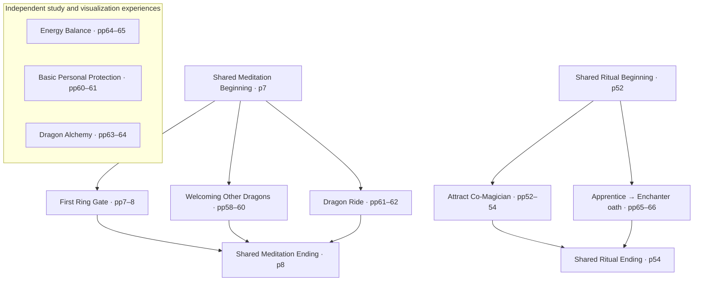

# DC-IMPLEMENTATION-004 — Integrating approved teachings into Dragon Cavern

**Date:** 2026-10-24
**Repository stage:** Research documentation and machine-readable integration specification. **No playable game is claimed to exist in this repository.**
**This integration design:** PROPOSED (not yet separately approved by William). **Its cited Atlas source records and source distinctions are user-approved**.
**Data graph:** [`game/data/atlas-experience-graph.v1.json`](../game/data/atlas-experience-graph.v1.json)
**Primary author:** D. J. Conway, *Mystical Dragon Magick: Teachings of the Five Inner Rings*; all spiritual events are the *book's descriptions/visualizations*, not demonstrated physical locations or effects.

## Why this matters

A reader may be guided through *meditation preparations*, *meditation journeys*, *ritual acts* and *study explanations*. These are not interchangeable. The book uses **two independent pairs** of explicitly labelled reusable blocks:

| Reusable component | Source printed page | Source label and end boundary | Scope |
|---|---|---|---|
| `meditation.beginning` | p.7 | “(Beginning of meditation)” → “(End of beginning)” | Seated, three breaths, white light/guardian spirits, well; **excludes First Ring gate** |
| `meditation.ending` | p.8 | “(Ending)” → “(End of meditation)” | Enter light, return to physical body, move fingers/feet |
| `ritual.beginning` | p.52 | “Beginning of ritual” → “End of beginning” | North-oriented cloth, salt/water placement, invocation and clockwise circuit |
| `ritual.ending` | p.54 | “Ending of ritual follows” → before new section | Water to plant/ground; put other items away |

**Do not substitute one pair for the other.** The co-magician ceremony has ritual-only objects and words *outside* the shared opening/ending, just as the First Ring Gate has a specific journey *between* shared meditation blocks.

## Experience composition — source-backed relations, not a claimed runnable app

**Diagram rule:** Graph edges indicate **reuse of book-referenced procedural blocks**, not physical corridors, gates or travel routes between worlds. The independent nodes deliberately have **no invented connections** to shared openings or other places.

### Exact integration table

| Experience ID | Presentation category (design proposal) | Documented composition | Approval for source facts |
|---|---|---|---|
| `experience.first-ring-introduction` | Guided meditation | p.7 beginning → First Ring gate/registry scene → p.8 ending | Approved p.7–8 |
| `experience.co-magician-ritual` | Ritual | Co-magician-specific materials → p.52 beginning → p.52–54 specific encounter → p.54 ending | Approved pp.52–54 |
| `experience.welcoming-other-dragons` | Guided meditation | p.7 beginning → castle courtyard/dragons/portals → p.8 ending | Approved pp.58–60 + pp.7–8 |
| `experience.basic-personal-protection` | Study / symbolic practices | Only the author's documented descriptions; no forced Otherworld location | Approved pp.60–61 |
| `experience.dragon-ride` | Guided meditation | p.7 beginning → green/gold dragon ride + question → p.8 ending | Approved pp.61–63 + pp.7–8 |
| `experience.dragon-alchemy` | Study | Essay on physical/magickal/spiritual alchemy; **no laboratory invented** | Approved pp.63–64 |
| `experience.testing-energy-balance` | Self-contained visualization | Golden pyramid support/board; dark end **first**, centre, bright end, centre | Approved pp.64–65 |
| `experience.apprentice-to-enchanter` | Ritual | p.65-specific objects/Full Moon preference → p.52 beginning → Aldram cave encounter/oath → p.54 ending | Approved pp.65–66 + pp.52–54 |

**Standalone exercise:** *Testing Your Energy Balance* does not explicitly cite pp.7–8 in the relevant text, so the graph does not add that meditation wrapper.

**Not a victory flag:** The Dragon Ride question and Apprentice-to-Enchanter oath ask about proceeding to a new Ring. The source must not be turned into an automatic promotion/score/acceptance state without separate design authorization.

## Explicitly separate three types of information

1. **SOURCE DESCRIPTION (S):** A line/scene/procedure taken from the book and preserved in a source-reviewed, user-approved Atlas entry, with its page citation.
2. **INTEGRATION EDGE (I):** A source-backed reference to a reusable block (e.g. p.58 tells us to use the meditation opening on p.7). Some edges are determined by the labelled construction of the example rite, not by a literal floor-plan connection.
3. **GAME DESIGN (G):** Visual style, camera, soundscape, click/hover mechanics, quest flags, persistence and dialogue presentation. All remain proposals, **not Conway source facts**, until separately designed and approved.

Each future interactive node should include `source_id`, `page`, `evidence_type`, `source_detail`, `unknown_fields`, `design_proposal`, and `approval_status`. If a visual element has no source description, mark `unspecified` rather than secretly filling it in.

## Non-negotiable spatial and actor separations

- **First Ring Gate** p.7–8 is **not** automatically Teacher's Gate, Past Lives Gate or any other named gate in the Otherworld Atlas.
- **Gate dragon** p.7–8 is only called a brightly coloured Gate guardian in this passage. Not Aldram, not Alberon, and not a designated player companion.
- **Aetherion** is **Dragon Cavern's original companion/game character**. He is **not named by Conway as the Gate dragon**, Aldram, guardian or co-magician. Existing blue book-dragon visuals and documented three-hop wing-spreading animation may belong in the game's UI as independent game material; don't turn them into book testimony. Flight is not an established behavior.
- The **stone courtyard without walls** of Welcoming Other Dragons (p.58) and the **castle with an outer wall and stone steps** of Dragon Ride (p.61) may visually resemble each other but **must not be declared identical**.
- The **physical altar** (p.65) and the **visualized cave** of Aldram are representational layers, not a proven single literal physical room.
- In co-magician ritual, **seven-point star/four named stones/Sunday or Monday** pertain to *that rite*, whereas the Enchanter ritual has **jewelry or belt buckle/Full Moon preference**. Do not duplicate the co-magician setup into the Enchanter ritual.
- Dark vs light in Energy Balance depicts **relative poles around a centre**; do not moralize them as enemies or claim an objective aura measurement.
- The page 63 answer explaining where magical power resides is **explanatory prose after** Dragon Ride meditation, not a required on-flight announcement or score.
- In all cases, avoid inventing precise dragon colours, cave dimensions, portal shapes, landscape coordinates, building geometry or scholarly certainty not present in the source.

## Prototype implementation order (future, NOT implemented in this commit)

**Project sequencing constraint:** [Mission 001 — Kaudra's Cave](001-kaudras-grotta.md) remains the previously established first source-checked worldbuilding milestone. Its map brief and user review must not be silently displaced by this experience-composition graph. The steps below describe a *possible technical integration order after* that project milestone, not a replacement priority or an already-approved development schedule.

1. **Atlas reader:** render each experience's source references and unknowns, including a visible S/I/G distinction.
2. **Reusable block runner:** present four shared blocks in reading order; do not turn books' visualizations into claims of physical travel.
3. **One separate first-entry scene:** gate with wood/iron, sound of bell, visible registry objects, Gate dragon unidentified beyond author's description. Preserve narrow room + slightly curved walls; ceiling unseen.
4. **Meditation scenes:** add Welcoming and Dragon Ride as separate source-traced experiences. Aetherion could appear only as independent UI companion.
5. **Ritual scenes:** co-magician rite and Enchanter oath with visible differences in the source. No confirmed promotion by default.
6. **Study panels:** Alchemy and Personal Protection rather than made-up scenes. For incense and candles, do not instruct dangerous flame/heat handling through game prompts.
7. **Energy Balance:** centre/dark/centre/bright/centre sequence with dragon's reassuring hold represented only as textually supported; no simulated real diagnostic score.
8. **Visual review:** no source-grounded object or creature image receives `user-approved` design status solely because its text is approved. Each illustrative model or texture must receive separate review.

The user has **not** asked to create an unapproved rendered scene at this step; no imagery or playable app is created here.

## Approval and implementation status

- **Research approvals:** confirmed in `atlas/DC-RESEARCH-002-Verified-P058-P066.md` and `atlas/DC-RESEARCH-003-Approvals-2026-10-24.md`.
- **Known record discrepancy:** The historical headers in the two individual p.7–8 files may still say approval “pending,” even though **the later approval ledger is canonical**. Those headers are stale metadata; this is not a withdrawal of approval.
- **This newly authored scene/composition graph:** **DESIGN PROPOSAL** awaiting William's review; source details remain approved.
- **No executable game exists** in the current GitHub repo. New JSON is a machine-readable reference blueprint, not a deployed experience or website.

## Next review checkpoint
William should approve the **composition connections**, especially the strict exclusion of First Ring gate from reusable meditation beginning, the castle distinction, p.52–54/p.65–66 ritual separation, and the decision to treat the two essays as study material rather than fabricated visual worlds. Review of the integration graph does **not** implicitly approve any future 3D/2D environment, source-invented character or gameplay effect.
